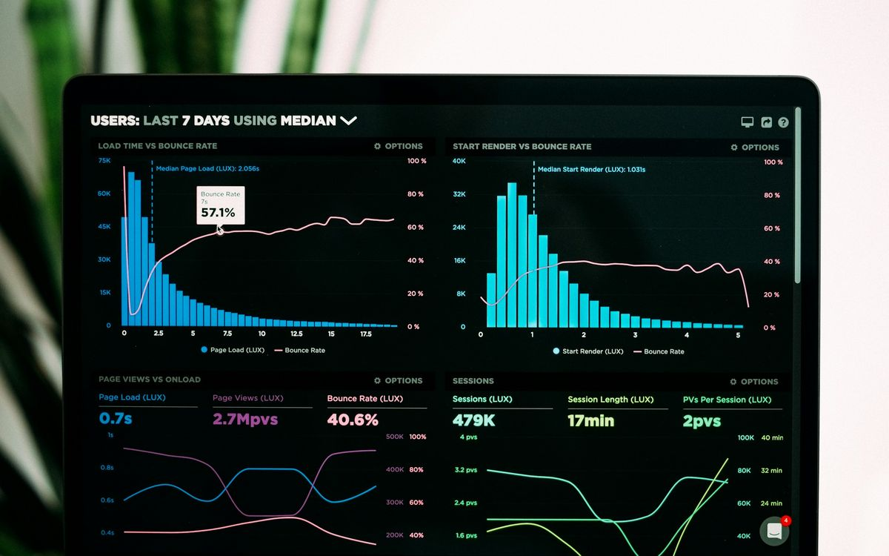

# Gate79 website: home page service cards, reference rebuild (Claude Code prompt)

Paste everything below the line into Claude Code, opened in `D:\Clients\Gate79\Website deign`.

---

# BRIEF: rebuild the home page "Everything the channel needs" service cards to match the client's reference

The client supplied a reference for the service cards: a grid of tall **dark cards**. Each card has:
- a moody image at the top;
- below it, a small square icon tile, a huge faint number ("01") in the top-right corner, an uppercase bold title, a muted description and a full-width outlined "EXPLORE SERVICE →" button.

The grid ends with one **solid accent card** ("Custom strategy?") that has a round white icon, a large condensed uppercase title and a white pill button. On hover, the card border, icon tile and title light up in the accent colour.

Match that **layout, proportions, typography and hover behaviour exactly**, but in Gate79's brand. The reference uses red, Amazon logos, gradients and glows, which the Gate79 brand rules forbid, so translate them like this:

| Reference | Gate79 version |
|---|---|
| Red accent (`#E31E24`-ish) | Ice `#95C3CF` |
| Text on the red CTA card (white) | Black (text on Ice is always Black) |
| Red gradient CTA card | Solid Ice card, no gradient |
| Red glow on hover | The site's one shadow token only, no coloured glow |
| Image fading into the card body | Hard edge with a 1px hairline (no gradient fade) |
| 3D renders with Amazon "a" logos, rockets, chess pieces | Real dark-toned stock photos, no logos (rules below) |
| Barlow-style condensed headings | Archivo at a condensed width (the brand font) |

Scope: only the services section on `index.html`, plus the CSS for it. Don't touch other sections or pages. Plain HTML/CSS/JS, as now.

## 1. Section and grid

- Section ground stays **Stone** (`--stone`). The section head is unchanged: eyebrow "Services", the H2 "Everything the channel needs, run as one", and the lede.
- Grid: `display:grid; gap: 28px;`
  - 3 columns at ≥ 1024px
  - 2 columns at 640–1023px
  - 1 column below 640px
  - The container max-width stays 1200px, so cards are about 368px wide at desktop (the same as the reference).
- Order:
  - Row 1: 01 Amazon advertising · 02 Listing optimisation · 03 Creative & A+ Content
  - Row 2: 04 Account management · 05 Brand Store & Registry · 06 Launch & expansion
  - Row 3: the CTA card.
- We have 6 services, not the reference's 8. So that row 3 isn't a lonely single card, the CTA card **spans all 3 columns at ≥ 1024** as a wide horizontal version (spec in 4.2) and spans 2 columns at 640–1023. On mobile it is a normal stacked card.
- Every card in a row is the same height (`align-items: stretch`). The buttons line up on one baseline.

## 2. Service card (dark)

Markup (one card; repeat for all six with their own number, icon, image and copy):

```html
<article class="svc-card2">
  <a class="svc-card2__hit" href="services/amazon-advertising.html" aria-label="Amazon advertising, explore service"></a>
  <div class="svc-card2__media">
    <picture>
      <source srcset="assets/img/stock/svc-advertising.webp" type="image/webp">
      
    </picture>
  </div>
  <div class="svc-card2__body">
    <span class="svc-card2__num" aria-hidden="true">01</span>
    <span class="svc-card2__icon" aria-hidden="true"><svg class="icon"><use href="#i-megaphone"/></svg></span>
    <h3 class="svc-card2__title">Amazon advertising</h3>
    <p class="svc-card2__desc">…</p>
    <span class="svc-card2__btn">Explore service <svg class="icon" aria-hidden="true"><use href="#i-arrow-right"/></svg></span>
  </div>
</article>
```

The whole card is clickable through the stretched `.svc-card2__hit` link (`position:absolute; inset:0; z-index:3`), so there are no nested links. The button is visual only and sits under the hit layer. Keyboard focus on the hit link shows a 2px Ice focus ring around the whole card.

Measurements are taken from the reference at a 368px card width:

| Part | Spec |
|---|---|
| Card | `background: var(--carbon)` (#111416); `border: 1px solid rgba(255,255,255,.07)`; `border-radius: 10px`; `overflow: hidden`; `display:flex; flex-direction:column; position:relative`; `color: var(--white)` |
| Media | `aspect-ratio: 368 / 222` (≈ 5:3), full bleed to the card edges (no inner margin), `border-block-end: 1px solid rgba(255,255,255,.06)`; image `object-fit: cover` with an `object-position` set per photo; background `var(--black)` while loading |
| Body | `padding: 36px 32px 32px`; `display:flex; flex-direction:column; flex:1; position:relative` |
| Ghost number | `position:absolute; top: 20px; right: 24px;` Archivo, `font-stretch: 62%`, weight 800, `font-size: 80px`, `line-height: 1`, `letter-spacing: -.02em`, `color: rgba(255,255,255,.045)`; `pointer-events:none` |
| Icon tile | 48×48px, `border-radius: 8px`, `background: rgba(255,255,255,.04)`, `border: 1px solid rgba(255,255,255,.09)`, centred icon 20px, stroke 1.5, `color: var(--ice)`; `margin-block-end: 32px` |
| Title | Archivo, `font-stretch: 100%`, weight 700, `font-size: 20px`, `line-height: 1.25`, `letter-spacing: .08em`, `text-transform: uppercase`, White; `margin-block-end: 20px`; `text-wrap: balance`; titles run to 2 lines like the reference |
| Description | Geist 15px, `line-height: 1.75`, `color: rgba(255,255,255,.62)`; `margin-block-end: 32px` |
| Button | `margin-block-start: auto`; full width; 48px tall; `border-radius: 4px`; `background: rgba(255,255,255,.03)`; `border: 1px solid rgba(255,255,255,.09)`; centred content with 12px gap; Geist 13px, weight 600, `letter-spacing: .16em`, uppercase, White; arrow icon 14px |

**Hover and focus state** (match the second reference image, minus the glow). Pointer devices only, 240ms `cubic-bezier(.2,.7,.2,1)`:
- Card: `border-color: var(--ice)`, `transform: translateY(-4px)`, `box-shadow: var(--shadow)`.
- Image: `transform: scale(1.04)` inside the media frame.
- Icon tile: `background: var(--ice)`, `border-color: var(--ice)`, and the icon turns `var(--black)`. No glow.
- Title: `color: var(--ice)`.
- Ghost number: `color: rgba(149,195,207,.10)`.
- Button: `background: var(--ice)`, `border-color: var(--ice)`, `color: var(--black)`. The arrow moves 4px right.
- Under `prefers-reduced-motion`: colours change, nothing moves or scales.
- On touch devices (no hover), cards stay in the resting state. The tap target is the whole card.

**Numbers and icons:**

| # | Service | Icon (use the sprite id; swap for the bespoke `i-svc-*` ids if the icons prompt has been run) |
|---|---|---|
| 01 | Amazon advertising | `#i-megaphone` → `#i-svc-ads` |
| 02 | Listing optimisation | `#i-tag` → `#i-svc-listing` |
| 03 | Creative & A+ Content | `#i-image` → `#i-svc-creative` |
| 04 | Account management | `#i-box` → `#i-svc-account` |
| 05 | Brand Store & Registry | `#i-shield` → `#i-svc-brand` |
| 06 | Launch & expansion | `#i-flag` → `#i-svc-launch` |

**Copy:** keep each card's current title and description from index.html. Remove the small tag pills ("Sponsored", "DSP" and so on), because the reference has none. If a description is longer than 4 lines at 368px, trim it to about 150 characters without changing its meaning.

## 3. Images (the reference look, the Gate79 rules)

The reference images are dark, moody, high-contrast scenes on near-black backgrounds with one accent colour. Recreate that mood with **real photography**:

- Use or replace the six `svc-*` photos so all six read as one set:
  - dark or charcoal backgrounds;
  - a single subject, lit dramatically;
  - cool tones;
  - at most small touches of blue or teal light (to echo Ice);
  - **no orange or red** dominance, which the current kitchen, pink-desk and warm photos have.
- Source: Unsplash or Pexels only. Download into `assets/img/stock/` as WebP (q78) plus JPG (q80) at 1200×724. Name them `svc-dark-<service>.webp`. Add each to `CREDITS.md`.
- Suggested subjects and search terms:
  1. **Advertising:** analytics charts on a monitor in a dark room ("dark monitor analytics", "trading screen dark").
  2. **Listings:** hands typing on a laptop with a backlit keyboard at night ("laptop keyboard dark night").
  3. **Creative:** a camera on a gimbal or a product being shot against a black backdrop ("camera gimbal dark studio", "product photography black background").
  4. **Account management:** warehouse shelving at night or with low light ("warehouse dark aisle").
  5. **Brand Store:** a dark minimal storefront or retail display ("dark retail display minimal").
  6. **Launch:** a container port or cargo ship at dusk or night ("container port night", "cargo ship dusk").
- **Never:** Amazon logos or smile arrows, readable third-party brands, rockets, chess pieces, puzzle pieces, 3D clip-art renders, AI-looking images, people pointing at screens.
- No CSS filters, overlays or gradient fades on the photos. Pick photos that are already dark.

## 4. The CTA card (replaces the current black "Not sure where to start?" bar)

### 4.1 Content and style (all sizes)
- Solid **Ice** background (`var(--ice)`), no gradient. `border-radius: 10px`. Same height as the cards in its row when it sits in a row (tablet).
- **Icon:** a 72px White circle with the shadow token, holding a 28px Black `#i-phone` icon (or `#i-79` / `#i-audit` if the icons prompt has been run).
- **Title:** "Not sure where to start?" Archivo, `font-stretch: 62%`, weight 800, `font-size: clamp(36px, 3.4vw, 44px)`, `line-height: 1`, uppercase, `letter-spacing: .01em`, **Black**.
- **Body:** "We map the right starting point for your account. The audit is a written teardown in 10 working days, scored against our 79-point standard." Geist 16px, `line-height: 1.6`, `color: rgba(2,1,1,.78)`, max 34ch.
- **Button:** a White pill, 52px tall, 28px horizontal padding, Geist 13px weight 700, `letter-spacing: .16em`, uppercase, Black text: "BOOK A GROWTH AUDIT →". It links to `contact.html`.
- **Hover:** the button background turns Black with White text and the arrow moves 4px. The card lifts 4px with the shadow token.
- Text and icon are centred, as in the reference.

### 4.2 Wide version (≥ 1024px, spanning 3 columns)
- `grid-column: 1 / -1`, 32px padding.
- A horizontal layout on a 12-column inner grid:
  - icon circle in columns 1–2;
  - title and body in columns 3–9, left-aligned, title on one line;
  - button in columns 10–12, right-aligned.
  - Everything is vertically centred, and the card is about 200px tall.

### 4.3 Narrower sizes
- 640–1023: it spans 2 columns, centred, using the stacked layout.
- Below 640: the stacked layout at full width, 48px vertical padding.

## 5. Responsive checks

- At 1024–1199, cards are about 300px wide. The title stays at 20px and may wrap to 3 lines. The ghost number drops to 64px. Body padding is 28px.
- At 390, cards are full width. The media keeps its 368/222 ratio, and body padding is 28px 24px.
- No horizontal scroll at 320–1920. The ghost number never overlaps the icon tile or title (it sits behind them; the icon and title have `position:relative; z-index:1`).

## 6. Cleanup

- Delete the old `.svc-card` markup and CSS for the home page only. Other pages still use `.svc-card` for "Other services" cards, so keep those rules. The new component is `.svc-card2`; rename it to `.svc-tile` if you prefer, but keep it in components.css under one commented block.
- Delete the `.svc-cta-card--wide` home bar and its CSS if nothing else uses it.
- Contrast check: the description at 62% White on Carbon must be at least 4.5:1 (it is about 7:1). Black on Ice passes.

## 7. QA (Playwright, then stop)

1. Screenshot the services section at 1366, 1024, 768 and 390, both at rest and with the first card hovered (`page.hover`). Put each next to the reference and check:
   - card proportions;
   - the image-to-body split;
   - the icon tile size and position;
   - the ghost number position and opacity;
   - title size and tracking;
   - button height and full width;
   - equal card heights;
   - aligned buttons;
   - the hover state (Ice border, Ice tile with Black icon, Ice title, Ice button).
2. Fail on any horizontal overflow, any clipped element, any image with `naturalWidth === 0`, or any console error.
3. Confirm by eye that no Amazon logo, no red or orange, no gradient and no glow appear anywhere in the section.

Output only the changed-file list, the four rest screenshots and one hover screenshot path.
