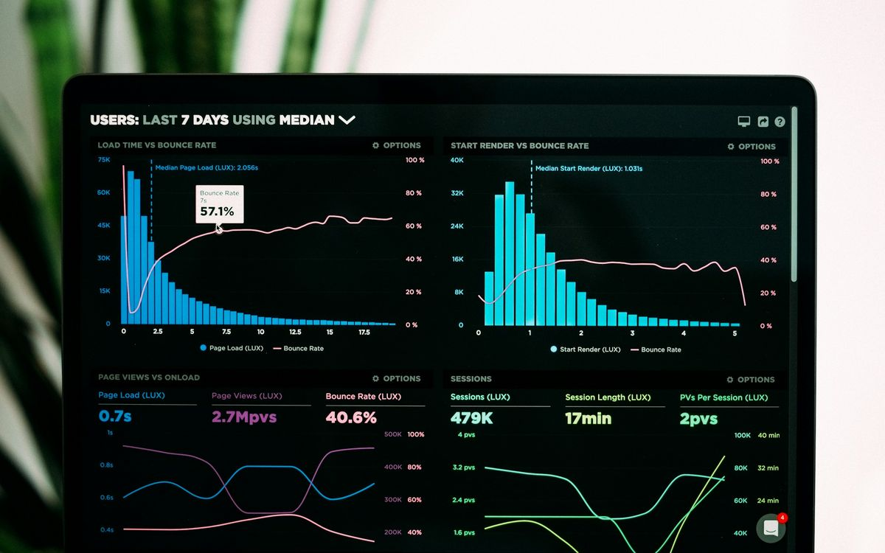

# Gate79 website: stock images for the design demo (Claude Code prompt)

Paste everything below the line into Claude Code, opened in `D:\Clients\Gate79\Website deign`.

---

# BRIEF: replace every code-built visual with real stock photography (demo build)

## 0. Goal and rules

This site is going to the client for **design approval**. Right now every media slot holds a code-built visual: an inline SVG/HTML block with `class="viz …"` (charts, dashboards, listing mock-ups, product silhouettes, initials tiles). Replace **every one of them** with a real, high-quality stock photo downloaded from the internet, so the demo looks like the reference sites in `D:\website references` (photo-led cards, product shots, team portraits, article covers).

Rules:
- **Sources: Unsplash (unsplash.com) and Pexels (pexels.com) only.** Both licences allow free commercial use with no attribution. Don't use Google Images, Shutterstock, Getty, Adobe Stock, Freepik, Pinterest or any watermarked or licence-unclear source.
- **Download every image into the project** (`assets/img/stock/`). No hotlinking: the site must still open from disk with no network except Google Fonts.
- **Don't build any visual in code.** No SVG charts, dashboards, mock-ups or silhouettes in media slots. Keep only the logo files, the small UI chips floating around the hero mark, icons and the text-based logo wall tiles (real brand logos would be trademark use).
- Don't change layout, copy, colours, fonts or components beyond what this brief asks. Brand rules still apply: no gradients, no filters, no overlays on photos.
- Work until section 6 passes, then output only the file tree and any blockers.

## 1. How to find and download images

1. Search with your web tools, for example `https://unsplash.com/s/photos/<query>` and `https://www.pexels.com/search/<query>/`, using the queries in section 3.
2. Open each candidate's photo page and **look at the image yourself before you use it** (download it and view it). Reject anything that breaks section 2.
3. Download the full image:
   - Unsplash: `https://unsplash.com/photos/<photo-id>/download?force=true`, or the `images.unsplash.com/photo-…` URL with `?w=2400&q=85&fm=jpg`.
   - Pexels: `https://images.pexels.com/photos/<id>/pexels-photo-<id>.jpeg?auto=compress&cs=tinysrgb&w=2400`.
4. Process each image with any tool already on this machine (Python + Pillow, ImageMagick, or `npx sharp-cli` as a one-off dev step; nothing gets added to the site): crop to the slot's aspect ratio with the subject kept in frame, resize to 2× the largest displayed width (most cards: 1200px wide; full-width splits: 1600px; team portraits: 960×1200), and export **WebP (quality 78) plus a JPEG fallback (quality 80)**. Target under 220 KB per WebP.
5. Name files by slot, e.g. `svc-advertising.webp`, `case-halcott.webp`, `team-03.webp`, `insight-tacos.webp`.
6. Record every image in `assets/img/stock/CREDITS.md`: filename, source site, photographer, original page URL, and where it is used. This file is for swapping in real photos later; it is not shown on the site.

## 2. Selection standard (reject anything that fails)

- **Looks like the references:** sharp, professional, well lit, real photography. Not AI-generated-looking, not cheesy, not obviously "stock" (no staged high-fives, no fake smiles at the camera in office scenes).
- **Fits the brand palette:** prefer cool and neutral tones (whites, greys, stone, black, cool blue). Avoid images dominated by orange, red or saturated warm colours. Pick images that already fit; don't recolour or filter them.
- **Never:** Amazon logos, smile arrows, Amazon-branded boxes or tape, Prime vans; visible third-party brand logos or readable product labels; watermarks; text-heavy screenshots; handshakes, rockets, piles of cash, people pointing at screens, isometric illustrations.
- **Consistency within a set:** team portraits share one look (similar background tone, framing and light); case-study product shots share one look (clean studio, plain backgrounds, one product per frame); article covers share one look (flat-lay or desk scenes, top-down or eye-level, cool light).
- **People:** diverse in gender, age and ethnicity across the site. Team portraits are head-and-shoulders, looking at camera, plain grey or dark background, business-casual.
- **No duplicates:** the same photo is never used twice on one page, and no more than twice across the site.

## 3. Slot map and search queries

Find every element with `class="viz` (there are about 120, listed by page below) and replace it with the photo for that slot. Use the slot's heading and the visual's current title to choose the subject.

| Slot group | Where | Count | Ratio | Subject and search queries |
|---|---|---|---|---|
| **Service cards: Advertising** | Home services grid, services.html, "other services" cards | ~6 | 16:10 | Analytics on a laptop or monitor in a calm, dark workspace. `analytics dashboard laptop dark`, `marketing data screen desk` |
| **Service cards: Listings** | same | ~6 | 16:10 | Person writing or editing copy, keyboard close-up, product page on a screen. `copywriting laptop desk`, `ecommerce product page screen` |
| **Service cards: Creative & A+** | same | ~6 | 16:10 | Product photography studio, lighting setup, photographer shooting a product on white. `product photography studio`, `photographer shooting product` |
| **Service cards: Account management** | same | ~6 | 16:10 | Warehouse shelving, inventory, fulfilment boxes (unbranded). `warehouse inventory shelves`, `fulfillment boxes unbranded` |
| **Service cards: Brand Store & Registry** | same | ~6 | 16:10 | Brand designer at work, brand moodboard, packaging design. `brand design studio`, `packaging design desk` |
| **Service cards: Launch & expansion** | same | ~6 | 16:10 | Shipping containers at port, cargo plane, world map on a wall, product boxes being packed. `container port logistics`, `global shipping` |
| **services.html sub-service cards** (3 per service, 18 total) | services.html | 18 | 16:10 | One distinct photo per sub-service title (e.g. "Search term harvesting" → spreadsheet review; "Main image systems" → product on white sweep; "Demand forecasting" → stock planning meeting; "Hijacker monitoring" → security/monitoring screen; "Vine & reviews" → unboxing at home). No repeats within the page. |
| **Process thumbnails** | Home "How we work" (Audit, Plan, Run, Report) | 4 | 4:3 | Audit: person reviewing printed report with a pen. Plan: whiteboard planning session. Run: team at desks working. Report: printed report and coffee on a desk. `business audit documents`, `whiteboard planning team`, `team working office`, `report on desk` |
| **Command centre split** | Home "The Gate79 way" dashboard | 1 | 4:3 | Modern dark office desk with multiple monitors showing charts (as in the ecommsyte reference). `multiple monitors office dark`, `trading desk monitors` |
| **Case-study product shots** | Home case tabs (4), work.html rows (9), case-study.html, service pages' related case study (6) | ~20 | 16:10 | Clean studio product photography on plain backgrounds, one product per frame, matched to each case's category: kitchen storage containers, skincare bottles, pet food or treat pouch, running belt / fitness gear, supplement jar, flat-pack furniture detail, beauty tool, desk organiser, table lamp lit. `kitchen storage containers minimal`, `skincare bottles minimal`, `supplement jar white background`, `table lamp product photo`. Labels unreadable or blank. |
| **Before/after cards and sliders** | work.html "Main images, before and after" (4), case-study.html (2) | 6 | 16:10 | Pairs of the same product type: "before" a casual phone photo on a cluttered surface; "after" a clean studio shot on white. `product on kitchen counter phone photo` + `same product white background`. Pair by category so the comparison reads. |
| **Team portraits** | Home team (4), about.html team (8) | 8 unique | 4:5 | Professional headshots, plain grey or charcoal background, consistent light. `professional headshot grey background`, `business portrait dark background`. 4 women, 4 men, mixed ages and ethnicities. Keep the names and initials badges as they are (SAMPLE). |
| **Video testimonial posters** | testimonials.html (3) | 3 | 16:9 | A founder speaking in their own workspace or small studio, mid-sentence, not looking at the camera. `founder interview office`, `small business owner talking`. Keep the play button over the image. |
| **Insights article covers** | insights.html (10), Home insights (4), article.html related (3) | ~12 unique | 16:10 | One per article topic: TACoS → laptop with charts; gallery order / main images → product flat lay; DSP → audience/data screen; Buy Box → price tags/retail shelf; harvesting → spreadsheet close-up; pricing tests → calculator and receipts; Brand Store → website design on screen; EU launch → European city or map; review velocity → phone with star rating; backend terms → keyboard close-up. Use the same cover for the same article everywhere it appears. |
| **Article body visuals** | article.html (4) | 4 | 16:9 | Desk scenes supporting each section (no charts). |
| **Service-page splits** ("What it is", "Who it's for") | each of the 6 service pages (2 each) | 12 | 4:3 | "What it is": the service being done (same theme as the service card but a different photo). "Who it's for": a founder or small brand team in their own space (studio, warehouse, kitchen workshop), relevant to the page. |
| **Service-page results visual** | each service page's related case study | 6 | 16:10 | The case's product shot (reuse that case's file). Keep the metrics as stat tiles beside it. |
| **About workspace** | about.html (and any about split) | 1 | 4:3 | Bright, modern small agency office, people working, unposed. `modern office team working` |

If you find a `viz` slot not covered above, pick the closest group's subject.

## 4. Markup and styling

- Replace each `viz` block with:
  ```html
  <picture>
    <source srcset="assets/img/stock/svc-advertising.webp" type="image/webp">
    
  </picture>
  ```
  Use `../assets/…` from `/services/`. Write real `alt` text per image (what it shows, not "stock photo"). Above-the-fold images: `loading="eager"` and `fetchpriority="high"` on the first one only.
- The image fills its existing frame: `display:block; width:100%; height:100%; object-fit:cover;` with the frame's current `aspect-ratio` and radius. Set `object-position` per image where the subject sits off-centre.
- Keep existing overlays that are part of the component: icon badges on service cards, initials badges on team cards, status pills on before/after cards, play buttons on video posters, caption plates ("FIG. 01 · …"). Caption plates and labels sit on a **solid** Black or White plate, never a gradient scrim.
- Before/after sliders keep their drag/keyboard behaviour, now comparing two photos of identical size.
- Hover: image scales to 1.04 inside its frame (existing behaviour); none under reduced motion.
- **Remove the dead code:** delete the `viz*` CSS rules and any JS that only animated them (chart draw, bar grow on visuals). Keep count-ups on stat tiles. Remove the old prepared `` comments inside slots.
- Delete `assets/img/IMAGE-LIST.md` (CREDITS.md replaces it) and update its references if any.
- Add a single HTML comment at the top of each page's `<main>`: `<!-- DEMO: stock photography from Unsplash/Pexels, see assets/img/stock/CREDITS.md; replace before launch -->`.

## 5. Performance

- Every `` has `width`, `height`, `loading` and `decoding` set; no layout shift.
- Total image weight per page: Home under 3.5 MB, other pages under 2.5 MB (WebP).
- Lighthouse Performance stays 90+ on Home and a service page.

## 6. QA (headless browser, then stop)

Open every page at 390px and 1366px with Playwright, scroll to the bottom (turn off smooth scrolling in the test so lazy images and reveals load), wait for images, take full-page screenshots and look at them.

- [ ] `grep -r 'class="viz' *.html services/*.html` returns nothing; no SVG charts or mock-ups remain in media slots.
- [ ] Every `` loads (no broken images, check `naturalWidth > 0`) from `file://` and from a local static server.
- [ ] Every image is from Unsplash or Pexels, listed in `CREDITS.md` with its source URL.
- [ ] Nothing in section 2's "Never" list appears in any image; sets look consistent; no photo appears twice on a page.
- [ ] No horizontal scroll at 320–2560px; images crop well at every width (faces and products not cut off).
- [ ] No console errors; page weights within section 5.
- [ ] Colour balance per page still roughly White+Stone 40%, Ice 35%, Black 25% (photos count toward their dominant tone; if a page drifts, swap a warm or dark photo for a cooler, lighter one).

Output only the final file tree and any blockers.
